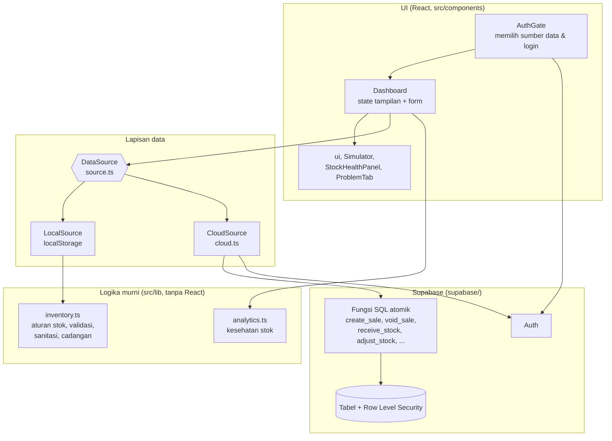

# Arsitektur StokCerdas

## Gambaran
Aplikasi web Next.js 14 (App Router) satu halaman. UI tidak pernah menyentuh penyimpanan secara langsung:
semua baca/tulis lewat **DataSource**, yang punya dua implementasi: lokal (browser) dan cloud (Supabase).

## Lapisan dan tanggung jawab
| Lapisan | Berkas | Aturan |
|---|---|---|
| Tampilan | `src/components/*`, `src/app/*` | Hanya menampilkan state dan memanggil `DataSource`. Tidak ada aturan bisnis. |
| Logika bisnis | `src/lib/inventory.ts` | Fungsi murni: terima state, kembalikan state baru atau galat. Gagal = tidak ada perubahan (atomik). |
| Analitik | `src/lib/analytics.ts` | Fungsi murni berbasis aturan (hari stok tersisa, modal tertahan, skor). |
| Sumber data | `src/lib/source.ts`, `src/lib/cloud.ts` | Satu antarmuka, dua implementasi. UI tidak tahu data ada di mana. |
| Database | `supabase/schema.sql`, `supabase/migrations/*` | Aturan yang sama dijaga ulang di database: constraint, RLS, fungsi atomik. |

## Keputusan desain
1. **Logika bisnis terpisah dari React.** Aturan stok bisa diuji tanpa browser (`tests/inventory.test.mjs`) dan dipakai ulang oleh dua sumber data.
2. **DataSource sebagai batas.** Mode lokal tetap berfungsi tanpa akun untuk demo/juri; mode cloud aktif otomatis bila variabel Supabase diisi.
3. **Aturan ditegakkan di dua tempat.** Browser memvalidasi demi pengalaman pengguna; database memvalidasi ulang demi keamanan. Klien tidak dipercaya.
4. **Operasi stok = fungsi PostgreSQL, bukan beberapa query dari browser.** Satu transaksi, baris produk dikunci `FOR UPDATE` dengan urutan tetap, sehingga stok terakhir tidak bisa terjual dua kali dan tidak ada deadlock. Terbukti oleh tes konkurensi.
5. **Fungsi `SECURITY INVOKER` + RLS.** Fungsi berjalan sebagai pengguna login, jadi RLS tetap berlaku; menebak UUID bisnis lain tidak berguna. `anon` ditolak.
6. **Snapshot harga dan modal di setiap baris penjualan.** Mengubah harga atau modal produk tidak mengubah laporan masa lalu.
7. **Muat ulang dari server setelah menulis (cloud).** Sederhana dan selalu konsisten; konsekuensinya satu round-trip tambahan per operasi.
8. **Data rusak tidak membuat aplikasi crash.** Data lokal dan berkas cadangan disanitasi saat dimuat; salinan data yang tak terbaca disimpan terpisah.

## Model keamanan
- Hanya URL dan **anon key** yang ada di browser. Service-role key tidak boleh ada di klien.
- Semua tabel punya RLS berbasis `businesses.owner_id = auth.uid()`; fungsi tidak bisa dipanggil oleh `anon`.
- Header keamanan di `next.config.mjs` (nosniff, frame deny, referrer policy, HSTS, CSP subset tanpa nonce).
- Belum ada: CSP penuh (butuh nonce), rate limiting, audit log, peran kasir vs pemilik.

## Pengujian (`npm test`, `npm run test:e2e`, `npm run test:sql`)
| Tingkat | Apa yang diuji | Berkas |
|---|---|---|
| Unit | Aturan stok, validasi, sanitasi, cadangan, analitik | `tests/inventory.test.mjs`, `tests/analytics.test.mjs` |
| Kontrak sumber data | LocalSource (persistensi, data rusak, penyimpanan penuh) dan CloudSource (pemetaan baris, parameter RPC, galat) memakai klien palsu | `tests/source.test.mjs`, `tests/cloud.test.mjs` |
| Database | Fungsi atomik, rollback, RLS antar pengguna, `anon` ditolak, konkurensi dua sesi, idempoten | `supabase/tests/run.sh` (PostgreSQL lokal sementara) |
| Skala | 210 ribu struk: latensi operasi inti di bawah RLS, rencana query memakai indeks, ukuran data | `supabase/tests/scale.sh`, `tests/bench.mjs` |
| UI end-to-end | Alur pengguna di Chromium: penjualan multi-item, retur, terima barang, opname, edit, persistensi, tema, ponsel | `tests/e2e/smoke.mjs` |

## Batasan yang diketahui
- **CloudSource belum diuji terhadap proyek Supabase sungguhan.** Yang teruji: fungsi SQL di PostgreSQL asli dan pemanggilan/pemetaan memakai klien palsu. Penghubung yang belum teruji: PostgREST, Supabase Auth, dan konfigurasi proyek Anda.
- Mode cloud memuat ulang data setelah tiap operasi: jendela 90 hari, per halaman 1000 baris, maksimum 30.000 baris per tabel (pemberitahuan bila terpotong). Angka dan batas lengkap: `SCALABILITY.md`.
- Foto produk disimpan sebagai teks base64 di tabel `products`; untuk produksi pindahkan ke Supabase Storage.
- Pemulihan cadangan dan reset demo hanya untuk mode lokal.
- Tidak ada sinkronisasi offline-ke-cloud: data mode lokal tidak otomatis pindah ke akun.
